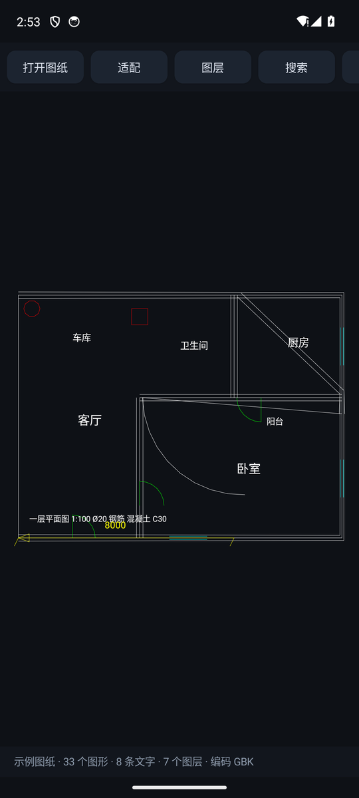

# CadLens

安卓上的 CAD 图纸查看器。装到手机上，打开图纸，看清线条和文字，能搜图里的字。

纯 Kotlin + 原生 Canvas，不依赖任何第三方 CAD 引擎，也不联网。

<p align="center">
  
  
</p>

## 现在能做什么

| | 状态 |
|---|---|
| 打开 **DXF**，画出线条、圆、弧、多段线、文字、标注 | ✅ 可用 |
| 平面图里的中文（GBK / Big5 / UTF-8 自动识别） | ✅ 可用 |
| 搜索图纸里的文字，点结果直接跳到那一段 | ✅ 可用 |
| 图层开关（按层隐藏/显示） | ✅ 可用 |
| 双指缩放、拖动、双击回全图 | ✅ 可用 |
| 两点量距离 | ✅ 可用 |
| 打开 **DWG**（2004/2007/2010/2013/2018） | ⚠️ 只读容器：版本、段表、对象数、内嵌缩略图 |
| 直接画 DWG 里的墙和线 | ❌ 还没做，见下文 |

DWG 不是不能读，是**对象层还没写完**。想马上出图，把图纸另存成 DXF（AutoCAD → 另存为 → AutoCAD 2000/2004 DXF），本 App 直接打开。

## 装

```bash
./gradlew :app:assembleDebug
adb install -r app/build/outputs/apk/debug/app-debug.apk
```

或者用 Android Studio 打开直接跑。需要 JDK 17、Android SDK 36。

也可以在文件管理器里点一个 `.dxf`，选 CadLens 打开。

首次启动会加载一张内置的示例平面图，不用先准备文件。

## 用

- **打开图纸**：系统文件选择器，DXF / DWG 都行
- **适配** / **双击**：整张图铺满屏幕
- **图层**：勾掉一层，那层的线立刻消失
- **搜索**：输入「排烟机房」这类词，列表里点一下就跳过去并高亮
- **测量**：点两个点，底部显示距离

## 它支持哪些 DXF 实体

`LINE` `CIRCLE` `ARC` `ELLIPSE` `LWPOLYLINE` `POLYLINE`+`VERTEX` `SOLID` `TRACE` `3DFACE` `POINT` `TEXT` `MTEXT` `ATTRIB` `INSERT` `DIMENSION`

块（BLOCK）会按基准点、缩放、旋转摊平展开，标注的匿名块也一样。

文字处理包括 `%%c` `%%d` `%%p` 控制码、`\P` 换行、`\fSimSun|b0;` 字体码、`\U+00B0` 转义、`{\...}` 分组。不支持二进制 DXF（会明确报错）。

## DWG 进度

R2004 之后的 DWG 是「加密头 + 段页映射 + LZ77 压缩段 + 分页句柄表」的结构。已经打通的是：

1. `0x80` 处的 0x78 字节加密头（LCG `rseed * 0x343FD + 0x269EC3`，取高位异或）
2. 段页映射表 → 44 个段
3. 段信息表 → 14 条描述（名字 / 页数 / 解压后大小 / 是否压缩）
4. 每页的加密段头，XOR key = `0x4164536B ^ address`
5. R2004 的 LZ77 变体，解出对象流（这张图 854 KB）
6. 分页句柄表：每页 2 字节页长 + `UMC` 句柄增量 + `MC` 地址增量 + 2 字节 CRC

第 6 步有个坑值得记下来：**地址累加器在每页开头归零**，但存的是段内全局字节偏移。跨页接着累会一路飘到几百万，一个对象都对不上；改成每页重置后，10867 个对象的地址全部落回 `[0, 875134]`，且**相邻对象 100% 首尾相接**（`addr + 4 + size == next_addr`，10866/10866）。所以容器层是对得上的。

还没做的是最后一层：对象头之后按类型解字段（`LINE` 的起终点、`TEXT` 的内容、`LAYER` 的颜色……）。这一层没有捷径，要照 DWG 的对象规范一个个写，或者把 LibreDWG 编成 `.so` 挂上 JNI。

## 测试

```bash
./gradlew :app:testDebugUnitTest
```

DXF 解析器有 11 个用例（词法、中文编码、圆弧方向、块变换、控制码）。

DWG 容器层拿真实图纸验，图纸不方便进仓库，所以走环境变量，没设就自动跳过：

```bash
CADLENS_DWG_SAMPLE=/path/to/plan.dwg ./gradlew :app:testDebugUnitTest
```

## 目录

```
app/src/main/java/dev/cadlens/
  MainActivity.kt        界面：工具栏、搜索浮层、图层、DWG 信息
  model/CadScene.kt      场景模型 + 文字搜索
  io/DxfReader.kt        DXF 解析（实体、块、编码、文字码）
  io/DwgProbe.kt         DWG 容器探针
  ui/CadCanvasView.kt    自绘视图：变换、手势、文字
  util/Aci.kt            AutoCAD 索引色 → ARGB
tools/make_sample.py     生成 samples/demo-floor.dxf
```

## 许可

MIT
