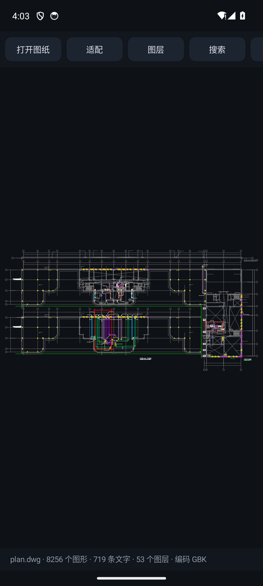
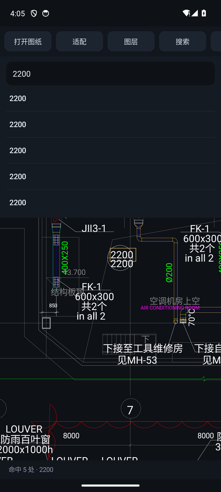

# CadLens

安卓上的 CAD 图纸查看器。**DWG 直接打开就能看图** —— 线、文字、图层、搜索，
都在这台手机上完成，不上传、不联网。

<p align="center">
  
  
</p>

上图是直接打开一张 407 KB 的鸿业暖通图（AC1018 / R2004）的结果：
**8256 个图形、719 条文字、53 个图层**，一次点击就出图。

## 怎么做到的

DWG 是 Autodesk 的私有二进制格式。自己从头啃对象层不现实 —— 那不是几百行的事，
是几万行的字段描述表加一堆版本差异。所以这里走的是**内置转换器**：

```
DWG 字节  ──►  LibreDWG（C，编进 APK 的 .so）  ──►  DXF 文本  ──►  自己的渲染管线
```

- **LibreDWG** 负责把 DWG 拆成 DXF，跑在设备本地，纯离线
- 解码出来的 DXF 交给本项目自己的解析器，和直接打开 DXF 走的是**同一条代码路径**

这样做的好处很实际：几何、块、标注、文字、编码转换只需要维护一份，
DWG 和 DXF 看到的图必然一致，也不会有两套 bug。

## 现在能做什么

| | 状态 |
|---|---|
| 打开 **DWG**（R13 ~ R2018，含 2004 / 2007 / 2010 / 2013 / 2018） | ✅ 直接出图 |
| 打开 **DXF**（ASCII） | ✅ 直接出图 |
| 线条、圆、弧、椭圆、多段线、填充、文字、标注、块参照 | ✅ 可用 |
| 中文图纸（GBK / Big5 / UTF-8 自动识别） | ✅ 可用 |
| 搜索图纸里的文字，点结果跳过去并高亮 | ✅ 可用 |
| 图层开关（按层隐藏/显示） | ✅ 可用 |
| 双指缩放、拖动、双击回全图 | ✅ 可用 |
| 两点量距离 | ✅ 可用 |
| 极远处的杂点自动剔除（不然整张图会缩成一个像素） | ✅ 可用 |

## 装

从 [Releases](https://github.com/r4x2t7/cadlens/releases) 下 APK 直接装，或者自己编：

```bash
./gradlew :app:assembleRelease      # 产物在 app/build/outputs/apk/release/
```

需要 JDK 17、Android SDK 36、NDK 28（编 LibreDWG 用）。首次会下载 CMake 依赖。

装好之后，在文件管理器里点任意 `.dwg` / `.dxf`，选 CadLens 打开即可。
应用也注册了 `application/dwg`、`application/dxf` 的 VIEW intent。

首次启动会加载一张内置示例平面图，不用先准备文件。

## 用

- **打开图纸** —— 选 DWG 或 DXF
- **适配** —— 缩放回全图
- **图层** —— 逐个开关，图层多的图可以先关掉没用的
- **搜索** —— 输中文或数字，回车列结果，点一条就飞过去（黄框标出）
- **测距** —— 点两个点，状态栏出距离

## 目录

```
app/src/main/java/dev/cadlens/
  io/DxfReader.kt      DXF 解析：实体 → 折线 / 文字
  io/DwgBridge.kt      DWG 入口：调原生库转 DXF
  io/DwgProbe.kt       DWG 容器探针（转不出来时用来看结构）
  model/CadScene.kt    渲染与搜索共用的数据模型
  ui/CadCanvasView.kt  自绘 View：缩放、拖动、拾取、高亮
app/src/main/cpp/
  dwg_bridge.c         JNI：dwg_read_file → dwg_write_dxf
  CMakeLists.txt       LibreDWG 静态库 + JNI
  libredwg/            内置的 LibreDWG 源码（见 NOTICE）
tools/                 取源码、裁剪码页表的脚本
```

## 关于内置的 LibreDWG

LibreDWG 是 GPL-3.0-or-later，静态链接进 APK 意味着**本项目整体也是 GPL-3.0**。
完整对应源码就是本仓库（含 `app/src/main/cpp/libredwg/`）。

为了控制体积，随附源码做了裁剪：只保留中文和西文五种码页，其余码页的查表项置空
（原样透传）；不含 JSON / GeoJSON 输入输出。复现脚本在 `tools/`。

LibreDWG 对厂商私有对象（天正、浩辰的代理实体）只能尽力而为，遇到画不出来的部分
属于上游能力边界，不是这里藏了一手。

## 已知限制

- DXF 只支持 ASCII 版；二进制 DXF 会明确报错
- 三维实体按平面投影画，没有 Z 轴
- 超大图纸（十万级实体以上）在低端机上首屏会慢几秒
- `armeabi-v7a` 的 .so 约 5.8 MB，装包会到 20 MB 上下

## 授权

GPL-3.0-or-later，见 [LICENSE](LICENSE) 与 [NOTICE](NOTICE)。
